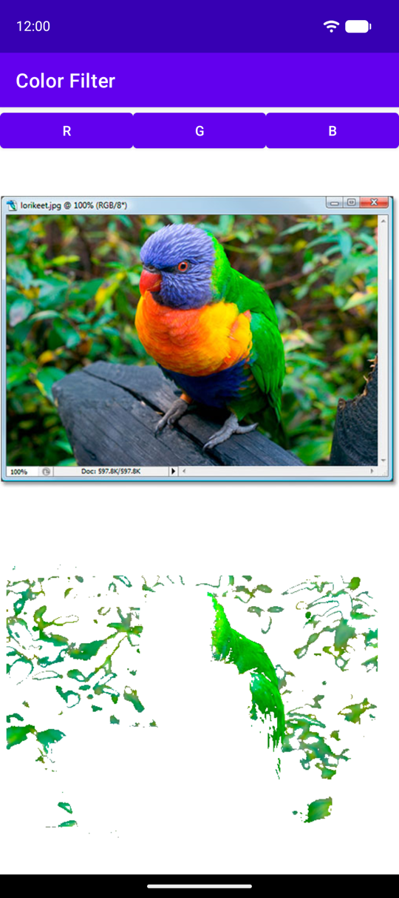

# Color Filter

A small Android app that isolates the red, green or blue parts of a photo.

The screen shows three buttons, **R**, **G** and **B**, above a sample photo (a rainbow lorikeet),
with an unfiltered copy of the photo below it. Tap a button and the copy is replaced by a filtered
version. It keeps only the pixels where that color dominates; everything else is made transparent.

   
  <em>After tapping <b>G</b></em>

## What color filtering is for

Color filtering means picking out the pixels of an image that fall within a chosen color and
ignoring the rest. It is one of the simplest ways for a program to "find" things in a picture,
and it is the first step in many image processing tasks:

- **Object detection and tracking:** find a red ball, a green marker or a blue sign in a camera
  frame by keeping only that color and looking at where the remaining pixels are.
- **Traffic and road signs:** red and blue regions are a quick first filter for stop signs and
  mandatory signs before more expensive recognition runs.
- **Green screen (chroma keying):** remove a solid colored background from video so another
  image can be placed behind the subject.
- **Industrial inspection:** check that colored parts, labels or wires are present and in the
  right place on a production line.
- **Accessibility:** highlight a single color so people with color vision deficiency can see
  which parts of an image are red or green.

This app shows the idea on a single photo.

## How the filter works

Every pixel has a red, green and blue value from 0 to 255. For the chosen color, a pixel is kept
when:

- that channel is **127 or higher**, and
- the other two channels are **below 127**.

Every other pixel becomes transparent. White, gray and black are always removed, because no
single channel stands out in them. Mixed colors such as yellow (red + green) or purple
(red + blue) are removed too.

On the lorikeet, **R** keeps the beak and the orange chest, **G** keeps the green wing and the
leaves, and **B** keeps the blue head and part of the wooden perch, which has a bluish tint. The
dark blue belly is mostly removed.
